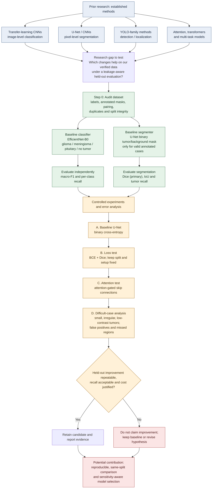

# Brain Tumor MRI: Existing Research vs. Proposed Work

**Status: research plan — planned improvements are hypotheses, not demonstrated results.**

The flowchart distinguishes established approaches in prior literature from this project's baseline and the controlled experiments planned after the data audit. It does not claim that the research question or the underlying techniques have never been studied.

## How to interpret it

### Already established in prior research
- CNN-based transfer learning for image-level classification.
- U-Net-style encoder-decoder segmentation.
- YOLO-family object detection/localization and related mask-prediction approaches.
- Attention, transformer and multi-task modeling, including the reviewed Swin-HAFNet direction.

These are existing research directions, not claimed inventions of this project.

### What this project will implement first
- A dataset audit and reproducible split protocol.
- An EfficientNet-B0 four-class image classifier.
- A separate U-Net binary segmenter, trained only when valid image-mask annotations are available.
- Independent evaluation before combining models in the local demo.

### What this project will test
A controlled comparison of BCE versus BCE + Dice loss, then attention-gated skip connections if warranted by error analysis, with special review of small, irregular and low-contrast tumors.

**Primary segmentation target:** Dice Similarity Coefficient (DSC). **Safety guardrail:** tumor sensitivity/recall. Also report IoU and inspect false-positive masks, including predictions on no-tumor images. For classification, report macro-F1 and per-class recall.

A change is retained only when held-out evidence supports it without unacceptable sensitivity loss or unjustified complexity. Training on real data and model metrics are pending; no improvement in accuracy or clinical utility is claimed. This is an academic research prototype, not a clinically validated diagnostic system.
